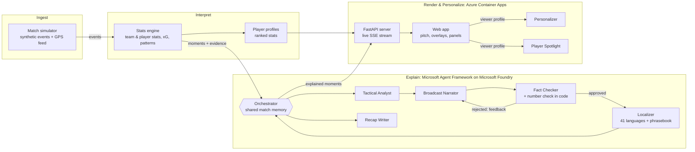

# MatchLens: explainable live match intelligence

**MatchLens turns a live feed of synthetic football events into explained, personalised match
intelligence.** A stats engine computes every number exactly, a team of AI agents built with
**Microsoft Agent Framework** on **Microsoft Foundry** explains why each moment matters, a fact
checker makes sure the explanation matches the data, and a web app renders it as broadcast-style
overlays tailored to each viewer: casual fan or analyst, any of 41 languages, their club, their
player.

- **Live demo:** _add your Azure Container Apps link here_
- **Demo video (under 2 minutes):** _add your YouTube link here_

> All clubs, players, venues and competitions are fictional. Every match is generated by the
> simulator in this repo.

## The five stages

| Stage (hackathon brief) | How MatchLens does it |
|---|---|
| **Ingest** synthetic events as they happen | `generate_match.py` simulates a full match (passes, shots, tackles, pressure, possession changes, penalties, aerial duels, cards, substitutions, a GPS-style physical feed) and streams it live |
| **Interpret** into stats, patterns and context | `engine/` updates team and player stats on every event: xG, xGOT, xA, possession, pressing, line-breaking passes, sprints, a full player profile ranked against everyone who played, and patterns such as momentum shifts, control vs chaos and pressing surges |
| **Explain** why moments matter | Seven agents (`agents/`): Tactical Analyst, Broadcast Narrator, Fact Checker, Localizer, Recap Writer, Personalizer, Player Spotlight |
| **Render** alongside the match | `app/` streams a live pitch with overlay cards timed and placed by the engine (full banner, lower third, corner badge), a momentum chart and team numbers |
| **Personalize** for every fan | Fan or Analyst mode, language, favourite club, followed player (highlighted on the pitch with a live stat card), and a pinned metric. The Personalizer rewrites moments for the viewer on demand |
| **Data out** for analysts and pipelines | One-click downloads of player, team, moment and minute-by-minute stats as CSV (spreadsheets) or JSON Lines (pipelines), live or full match, with a data dictionary |

## Architecture



## Why the agents can be trusted on air

- **Numbers come from code, not the model.** The engine computes every stat; agents only explain them.
- **Every number the AI writes is checked** against the source data in code, then the Fact Checker
  agent reviews the claims. If either finds a problem, the Narrator rewrites with the feedback.
- **Graceful failure:** rate limits, timeouts and invalid output are retried with back-off. If the
  narration still fails, the overlay shows the engine's factual headline instead, so it's never empty and never wrong.
- **Shared memory:** the orchestrator keeps the storyline so far, so agents connect moments
  ("their second big chance since switching to a high press") instead of treating each one alone.
- **Traceable:** every agent call is logged (agent, status, attempt, time) and shown live in the app's Agents tab.

## Validation

- The simulator's averages match real top-flight matches (about 3 goals, 1,060 passes at 84%,
  0.35 penalties, 11 km and 20 sprints per outfield player). See `matchsim/README.md`.
- The simulator logs every tactical change it makes. On 40 unseen matches the engine detected
  **79%** of them within 12 minutes, and reported every goal.
- **22 automated tests**, including fault injection: invented numbers, fact-checker rejections,
  rate limits, dead agents and invalid JSON are all recovered from.

## Microsoft technology used

- **Microsoft Foundry**: model deployment (gpt-4.1-mini) and project
- **Microsoft Agent Framework**: all seven agents, structured outputs
- **Azure Container Apps**: hosts the web app, with the API key stored as a secret
- **GitHub Codespaces** and **GitHub Copilot**: development environment and coding assistant

## Submitting (for the author)

`cd matchsim && bash finish.sh` runs the tests, makes sure the demo match is AI-explained, saves
to GitHub, deploys to Azure and fills in the demo link. After uploading the video:
`bash finish.sh --video <link>`. The video plan is in `VIDEO_SCRIPT.md`.

## Run it

```bash
cd matchsim
pip install -r requirements.txt
python -m pytest -q tests                                          # 22 tests, no Azure needed
python explain_match.py matches/match_00007 --offline --limit 5    # agents with a stand-in model
uvicorn app.server:app --port 8000                                 # web app on http://localhost:8000
```

With Azure: run `setup_azure.sh` (creates the Foundry resource, project and model deployment and
writes `.env`), then `python explain_match.py matches/match_00007 --languages all` for a fully
AI-explained match, and `deploy_azure.sh` to publish the app. Details in `matchsim/README.md`.

## Credits

Built for the Microsoft Premier League Hackathon. The football phrasebook idea was inspired by
LEaF Translations' guide to football idioms; the entries and descriptions are our own.
